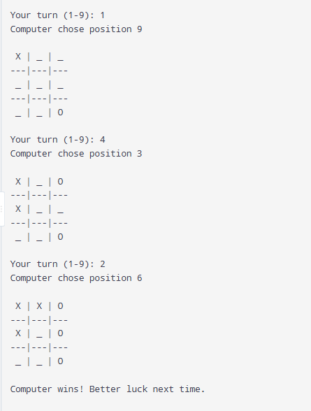

# Tic-Tac-Toe-PF-LAB-Project

## A. Project Introduction

This project is a console-based Tic Tac Toe game written in C. It allows a user to
play either against another human player or against a simple computer opponent that
selects random available moves. The program implements core C concepts including
2D arrays (for the game board), functions, loops, conditionals, and basic input
validation. Core features include a numbered position guide, win detection across
rows, columns, and diagonals, tie detection, and protection against invalid or
already-occupied moves.

## B. Features & Test Cases (Execution Scenarios)

* **Case 1: Player vs Player**
  * Description: Tests a full two-player game where Player 1 (`X`) and
    Player 2 (`O`) alternate turns on the same board.
  * Inputs: Alternating positions (1-9) entered by Player 1 and Player 2.
  * Expected Output: The board updates after each move, and the program
    correctly declares the winning player or a tie.
  * Screenshot: 

* **Case 2: Player vs Computer**
  * Description: Tests a full game where the human plays as `X` against the
    computer (`O`), which picks a random open cell on its turn.
  * Inputs: A sequence of positions (1-9) entered by the player.
  * Expected Output: The board updates after each move, and the game correctly
    announces a win, loss, or tie when the end condition is reached.
  * Screenshot: 

* **Case 3: Invalid Input & Error Handling**
  * Description: Tests how the program responds to out-of-range or
    already-occupied positions.
  * Inputs: A number outside 1-9, and a number corresponding to a cell that is
    already filled.
  * Expected Output: An "Invalid move or spot already taken!" message is shown,
    and the player is prompted to try again without crashing or skipping a turn.
  * Screenshot: 

## Instructions to Clone and Execute

### Step 1: Clone the Repository

```bash
git clone https://github.com/Murtuza76/Tic-Tac-Toe-PF-LAB-Project.git
cd Tic-Tac-Toe-PF-LAB-Project
```

### Step 2: Compile the Code

```bash
gcc main.c -o tictactoe
```

### Step 3: Run the Program

**Windows (Command Prompt):**
```bash
tictactoe.exe
```

**macOS / Linux:**
```bash
./tictactoe
```
