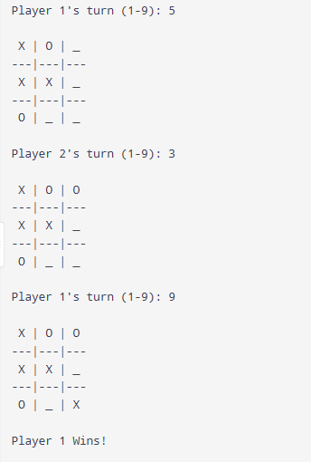
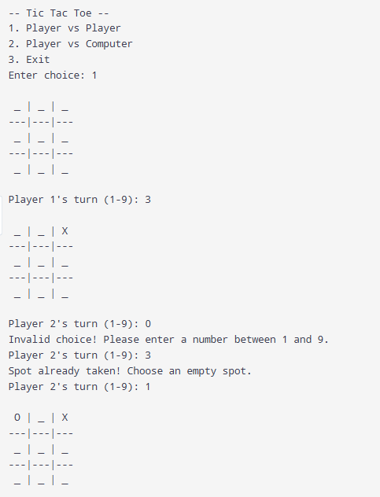

## Project Introduction

This project is a console-based Tic Tac Toe game written in C. A player can face
another human or a computer opponent that picks random open cells. The program
uses core C concepts: 2D arrays for the game board, functions, loops, conditionals,
and input validation. It includes a numbered position guide, win detection across
rows, columns, and diagonals, tie detection, and checks that reject invalid or
already-occupied moves.

## Features & Test Cases

* **Case 1: Player vs Player**
  * Description: Runs a full two-player match, with Player 1 (`X`) and Player 2
    (`O`) alternating turns on the same board.
  * Inputs: Alternating positions (1-9) entered by Player 1 and Player 2.
  * Expected Output: The board updates after each move, and the program
    correctly declares the winning player or a tie.
    
    

* **Case 2: Player vs Computer**
  * Description: Runs a match where the human plays `X` against the computer
    (`O`), which picks a random open cell on its turn.
  * Inputs: A sequence of positions (1-9) entered by the player.
  * Expected Output: The board updates after each move, and the game announces
    a win, loss, or tie once the game ends.
    
    

* **Case 3: Invalid Input & Error Handling**
  * Description: Checks how the program responds to positions outside 1-9 and
    to cells that are already filled.
  * Inputs: A number outside 1-9, and a number corresponding to a cell that is
    already filled.
  * Expected Output: An "Invalid move or spot already taken!" message appears,
    and the player is prompted to try again without crashing or skipping a turn.
    
    

## Instructions to Clone and Execute

### Step 1: Clone the Repository

```bash
git clone https://github.com/Murtuza76/Tic-Tac-Toe-PF-LAB-Project.git
cd Tic-Tac-Toe-PF-LAB-Project
```

### Step 2: Compile the Code

```bash
gcc main.c -o tictactoe
```

### Step 3: Run the Program

**Windows (Command Prompt):**
```bash
tictactoe.exe
```

**macOS / Linux:**
```bash
./tictactoe
```
